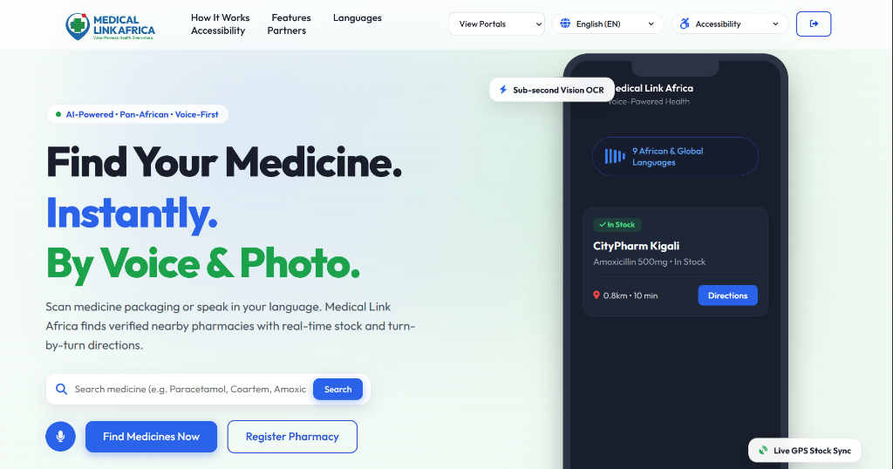
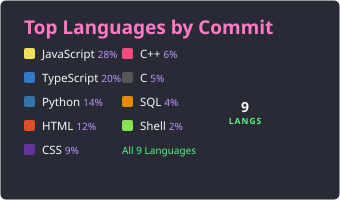

  
  <b>Mathew Kenyi Isaac</b> 
  <em>Software Engineer &amp; Techpreneur</em>  
   BSc Computer Science — <strong>University of Kigali</strong> 
   Full-Stack Developer  
   Building software solutions that solve real community challenges

  
  
  
  
  &nbsp;&nbsp;
  

 

---

## About Me

I'm a software developer focused on building practical applications, well-structured software, and AI-powered solutions. I enjoy exploring how technology works under the hood, solving programming challenges, and turning ideas into functional projects.
 

## Tech Stack & Skills

### Languages &amp; Core

  &nbsp;
  &nbsp;
  &nbsp;
  &nbsp;
  &nbsp;
  &nbsp;
  

### Frameworks &amp; Libraries

  &nbsp;
  &nbsp;
  &nbsp;
  

### Databases, Services &amp; Tools

  &nbsp;
  &nbsp;
  &nbsp;
  &nbsp;
  &nbsp;
  &nbsp;
  &nbsp;
  

 

## Featured Projects

<!-- Compact 3x2 Projects Grid (All 6 projects visible without scrolling) -->
<table width="100%">
  <!-- Row 1: Medical Link Africa | KenovaLabs | Open Source Kigali -->
  <tr>
    <td width="33.3%" valign="top">
      
      <h3>Medical Link Africa</h3>
      

        AI-powered voice &amp; vision telemedicine platform with OCR medicine scanning, multilingual voice navigation across 9 languages, and live pharmacy inventory.
      

      

        &nbsp;
        &nbsp;
        &nbsp;
        
      

      

        
      

    </td>
    <td width="33.3%" valign="top">
      <h3>KenovaLabs</h3>
      

        KenovaLabs is a technology company focused on building intelligent, scalable, and practical digital solutions. We combine artificial intelligence, software engineering, and automation to help businesses streamline operations, improve decision-making, and turn ideas into impactful technology.
      

      

        <em>Our mission is to build reliable technology that solves real-world challenges and contributes to Africa’s digital future.</em>
      

      

        &nbsp;
        &nbsp;
        &nbsp;
        
      

    </td>
    <td width="33.3%" valign="top">
      <h3>Open Source Kigali (OSK)</h3>
      

        Official community platform for Open Source Kigali, showcasing tech events, onboarding contributors, and enabling open-source collaboration across Rwanda's developer ecosystem.
      

      

        Fosters developer growth, technical workshops, hackathons, and cross-border open-source knowledge sharing.
      

      

        &nbsp;
        &nbsp;
        &nbsp;
        
      

      

        
        &nbsp;
        
      

    </td>
  </tr>

  <!-- Row 2: Past-Paper E-Library | Personal Portfolio | Weather App -->
  <tr>
    <td width="33.3%" valign="top">
      <h3>Past-Paper E-Library</h3>
      

        Zero-cost academic platform converting multi-page past examination papers into structured Markdown, DOCX, and PDF formats using Google Gemini 2.0 Flash multimodal AI and automated summarization.
      

      

        &nbsp;
        &nbsp;
        &nbsp;
        
      

      

        
      

    </td>
    <td width="33.3%" valign="top">
      <h3>Personal Portfolio</h3>
      

        Modern interactive developer portfolio showcasing software engineering projects, technical skillsets, academic background, and direct professional contact channels.
      

      

        &nbsp;
        &nbsp;
        &nbsp;
        
      

      

        
        &nbsp;
        
      

    </td>
    <td width="33.3%" valign="top">
      <h3>Weather App</h3>
      

        Real-time meteorological forecasting web application providing current atmospheric metrics, temperature trends, forecast charts, and location-based meteorological lookups.
      

      

        &nbsp;
        &nbsp;
        &nbsp;
        
      

      

        
        &nbsp;
        
      

    </td>
  </tr>
</table>

 

## GitHub Metrics & Activity

  
    
  
  &nbsp;
  
    
  
  &nbsp;
  

 

### Contribution History

  
<strong>Click to view commit activity snake animation</strong>

   
  <picture>
    <source media="(prefers-color-scheme: dark)" srcset="https://raw.githubusercontent.com/mathewkenyi07/mathewkenyi07/output/github-snake-dark.svg">
    <source media="(prefers-color-scheme: light)" srcset="https://raw.githubusercontent.com/mathewkenyi07/mathewkenyi07/output/github-snake.svg">
    
  </picture>

 

---

  

